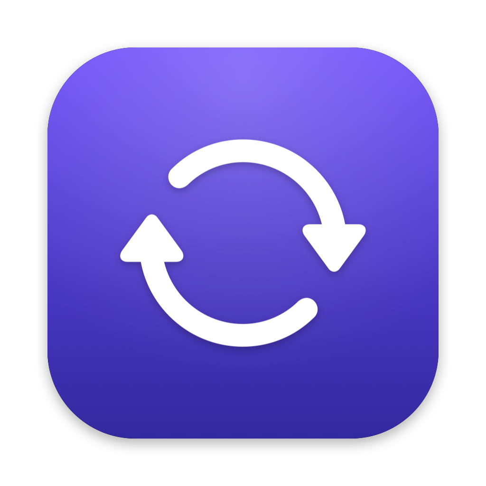
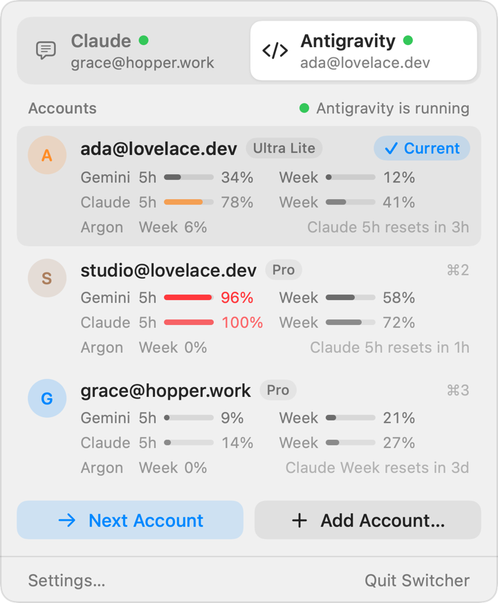
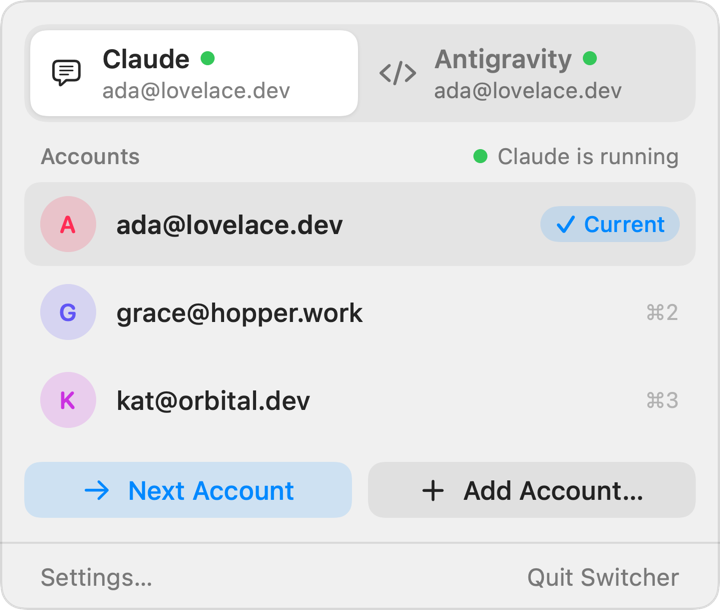

<p align="center">
  
</p>

<h1 align="center">Switcher</h1>

<p align="center">
  One click to move <b>Claude Desktop</b> and <b>Antigravity</b> to another of your accounts.<br>
  A native macOS menu bar app. No re-login, no copy-pasting tokens.
</p>

<p align="center">
  <a href="#install">Install</a> ·
  <a href="#how-it-works">How it works</a> ·
  <a href="README.zh-CN.md">中文</a>
</p>

<p align="center">
  <picture>
    <source media="(prefers-color-scheme: dark)" srcset="docs/popover-dark.png">
    
  </picture>
  <picture>
    <source media="(prefers-color-scheme: dark)" srcset="docs/claude-dark.png">
    
  </picture>
</p>

## What it does

- **Switch accounts in one click.** Pick an account from the menu bar. Switcher quits the app, puts that
  account's sign-in in place and opens the app again, already signed in. An Antigravity switch
  takes about two seconds.
- **Next account.** One button moves to the next account in your list, skipping the ones you turned off.
- **Antigravity quota for every account.** See each account's Gemini and Claude quota (5-hour and
  weekly) side by side, so you know which one still has room before you switch.
- **Add accounts the normal way.** "Add account" opens the app on its sign-in page. Sign in as usual
  and Switcher remembers it; the account you left stays saved.
- **Knows who you are.** Each account is shown by its email, read from the app's own files.
- **Claude Code, Codex and Antigravity CLI accounts.** Choose which account new `claude`, `codex` and
  `agy` terminal sessions use, and see each account's quota. These are separate from the desktop apps:
  switching a CLI account changes only which account *new* `claude` / `codex` / `agy` processes use.
  Running sessions keep theirs, nothing quits, and Claude Desktop, ChatGPT and Antigravity Desktop are
  not affected. Switching a desktop app works as before. See
  [CLI accounts](#cli-accounts-claude-code-codex-and-antigravity-cli).
- **CLI included.** `switcher list`, `switcher switch claude 2`, `switcher usage` and more.

## Install

**Homebrew**

```sh
brew install --cask raydocs/tap/switcher
```

**Download.** Grab `Switcher.zip` from [Releases](https://github.com/raydocs/switcher/releases), unzip
it into `/Applications`, then run `xattr -dr com.apple.quarantine /Applications/Switcher.app` once.
The build is ad-hoc signed (not notarized), so macOS blocks it without that step.

**From source** (Xcode 16 or the Swift 6 toolchain):

```sh
git clone https://github.com/raydocs/switcher && cd switcher
scripts/bundle.sh && cp -R dist/Switcher.app /Applications/
```

Requires macOS 14 or later.

## CLI accounts (Claude Code, Codex and Antigravity CLI)

Each account gets its own folder, and Switcher points new terminal sessions at one of them.

- **Profile folders.** `~/.claude-profiles/<name>` for Claude Code, `~/.codex-profiles/<name>` for
  Codex, and `~/.agy-profiles/<name>` for Antigravity CLI. Account 1 is the default: your normal
  `~/.claude`, `~/.codex` and `~/.gemini`, untouched.
- **A pointer.** `~/.config/switcher/active-claude`, `active-codex` and `active-agy` each hold one
  line: the folder new processes should use. `switcher cli use` rewrites that line and nothing else.
  No credential moves.
- **Shims.** `switcher cli install` puts small `claude`, `codex` and `agy` shims in
  `~/.local/share/switcher/bin` and adds one PATH line at the end of `~/.zshrc`. A shim reads the
  pointer, sets `CLAUDE_CONFIG_DIR`, `CODEX_HOME` or `ANTIGRAVITY_GEMINI_DIR` (plus `--gemini_dir` for
  normal `agy` commands) for that process, and runs the real CLI. For the default account it sets
  nothing. `switcher cli uninstall` removes both.
- **Shared settings.** A new profile symlinks your configuration and history from the default folder,
  so `--resume` still finds your sessions after a switch. Shared (Claude Code): `agents`, `commands`,
  `skills`, `plugins`, `scripts`, `hooks`, `projects`, `file-history`, `todos`, `CLAUDE.md`,
  `settings.json`, `keybindings.json`, `history.jsonl`. Shared (Codex): `skills`, `plugins`, `rules`,
  `prompts`, `sessions`, `archived_sessions`, `AGENTS.md`, `config.toml`, `session_index.jsonl`,
  `history.jsonl`. Shared (Antigravity CLI): `GEMINI.md`, `settings.json`, `skills`, `policies`, and
  `antigravity-cli/{settings,keybindings,hooks,mcp_config}.json`, `conversations`, `brain`. Everything
  else stays per account: the sign-in, caches, databases and, for Claude Code, `.claude.json`. Named
  `agy` profiles keep a fresh `antigravity-cli/cache/antigravity-keyring-unavailable` marker so their
  OAuth token stays in `antigravity-cli/antigravity-oauth-token` without touching Antigravity Desktop's
  keychain item.

The folder layout is the same one [token-arcade](https://github.com/raydocs/token-arcade) uses (plus
`~/.agy-profiles`). Switcher also coexists with Orca: if `CLAUDE_CONFIG_DIR`, `CODEX_HOME` or
`ANTIGRAVITY_GEMINI_DIR` is already set, the shim passes it through untouched. Set `SWITCHER_BYPASS=1`
to skip the shim for one command.

**Quick start**

```sh
switcher cli install                 # shims and the PATH line; open a new terminal afterwards
switcher cli add cc                  # sign in to another account in the browser; offers to switch
switcher cli use cc you@example.com  # new `claude` processes use that account (or: a number, a name)
switcher cli exec co 2 -- codex      # run Codex as account 2, once, without changing the pointer
switcher cli usage                   # quota of every profile
switcher cli doctor                  # check shims, sign-ins, links and keychain items
```

**Commands**

| Command | What it does |
|---|---|
| `switcher cli [list] [--json]` | Every profile, who it is signed in as, and which is active |
| `switcher cli use <cli> [<who>]` | New `claude` / `codex` processes use this account (no `<who>`: the next one) |
| `switcher cli add [<cli>] [<name>]` | Add an account: the CLI's own sign-in opens the browser, then it offers to switch. The folder is named `account2`, `account3`, … unless you give a name; a cancelled sign-in leaves nothing. Says so when it is an account you already have. `--no-login`: folder only; `--use`: switch without asking |
| `switcher cli login <cli> [<who>]` | Sign an account in again (default: the active one) |
| `switcher cli remove <cli> <who> [--yes]` | Sign an account out and move its folder to the Trash (never the default account; shared sessions and settings stay) |
| `switcher cli link [<cli>]` | Link shared settings into every profile |
| `switcher cli exec <cli> <who> [-- <command> [args]]` | Run a command (default: the real CLI) as one account |
| `switcher cli install [--no-rc]` | Install the shims and the `~/.zshrc` line (`--no-rc`: shims only; you put the folder on PATH) |
| `switcher cli uninstall` | Remove the shims and the rc lines |
| `switcher cli doctor` | Check shims, sign-ins, links and keychain items |
| `switcher cli usage [<cli>] [--renew]` | Read each profile's quota now; `--renew` lets the CLI renew an expired sign-in |
| `switcher cli usage [<cli>] --json` | The same as JSON (`switcher.usage.v1`): each account's windows, room left, an even-pace mark, and the account with the most room |
| `switcher cli usage [<cli>] --cached` | The last readings as JSON, without any request, process or keychain access (for scripts and status bars) |

`<cli>` is `claude`, `codex` or `agy` (`cc` / `co` / `antigravity`). `<who>` is a number (1 = the
default account), a name, the email it is signed in as, or `default`.

In the menu bar app, **Add Account…** under Claude Code, Codex or Antigravity CLI does the same with
one click: the browser opens, and the account appears once you have signed in (Cancel, or **Use
Terminal Instead** if no browser opened). Accounts are listed by email; a folder is never renamed
after sign-in, because Claude Code names its keychain item after the folder's path.

**Usage at a glance.** Each account shows its 5-hour and weekly use, with a mark on the weekly bar
where an even pace would be. When the active account passes 80 %, the account with the most room
left is tagged **Most room**. The menu bar icon can show two bars (5-hour over weekly) for the
active account closest to its limit (Settings → General).

The menu keeps the active accounts' numbers current while it is closed, and does it cheaply. The
system schedules the check about every 5 minutes and folds it into other wake-ups. The check itself
looks at a few file dates. A read (a request, or a `codex app-server` process) happens only when the
CLI ran since the last reading, or when the reading is over 30 minutes old. The other accounts are
read when the menu opens, and in the background only while the active account is low. Failures
back off from 5 minutes to an hour, and a rate limit waits the full hour. In Low Power Mode every
interval doubles, and nothing runs while the screens sleep. A window whose reset time has passed is
shown as 0 % when the CLI has not run since; otherwise it is left out until the next reading.

## How it works

An app's sign-in is a handful of files and keychain items. Switcher moves them; it never decrypts,
reads or sends your credentials anywhere.

| App | What a sign-in is |
|---|---|
| Claude Desktop | The claude.ai web session (cookies, local and session storage, IndexedDB) and the token cache keys in `config.json`, all still encrypted by Claude's own key |
| Antigravity | The OAuth token in the login keychain (`gemini` / `antigravity`) and the onboarding keys in `app_storage.json` |
| Claude Code CLI | The keychain item `Claude Code-credentials[-<8 hex of sha256(folder)>]` and `.claude.json` in the profile folder. Nothing is moved |
| Codex CLI | `auth.json` in the profile folder. Nothing is moved |
| Antigravity CLI | `antigravity-cli/antigravity-oauth-token` in named profile folders (or the login keychain `gemini` / `antigravity` item for `default`). Nothing is moved |

Each switch is journaled: the app is quit first, the current sign-in is set aside, the target one is
put back, and the journal is committed only once everything is on disk. If anything fails halfway, or
the Mac loses power, the next start finishes or undoes it, so you are never left with half of two
accounts. Sign-ins are moved, never copied, so a saved sign-in is only ever in one place.

Saved sign-ins live in `~/Library/Application Support/Switcher/`.

**Network.** Switcher makes these requests, and no others:

- Antigravity quota (desktop and CLI): for each account it refreshes that account's own token in
  memory and asks Google Cloud Code for its quota. Profile token files are never rewritten.
- Claude Code quota: `https://api.anthropic.com/api/oauth/usage`, with that profile's own access
  token, and only when there is no fresh statusline reading.
- Codex quota: through the local `codex app-server`, which talks to OpenAI itself.

Switcher never writes refreshed CLI tokens back to disk. `switcher cli usage --renew` runs one
minimal `claude -p` (a tiny Haiku request) so Claude Code renews its own sign-in. Nothing else is sent.

## Known limitations

- Tested with Claude Desktop 4.23118 and Antigravity 2.31. Both apps change how they store sign-ins
  from time to time; after an update, switch once and check you landed on the right account.
- GUI-launched CLIs and IDE plugins that don't go through PATH always use the default account.
- A shell rc that puts another folder ahead of Switcher's line defeats the shims. `switcher cli doctor`
  warns about it.
- Tested with Claude Code 2.1.323 and Codex 0.167.2.
- Claude Desktop's plan usage isn't shown (the app no longer keeps it in a readable file).

## Not affiliated

Switcher is an independent project. It is not made, endorsed or supported by Anthropic or Google.
Claude and Antigravity are trademarks of their owners. Use it only with accounts you own, and follow
each service's terms.

## License

[MIT](LICENSE)
