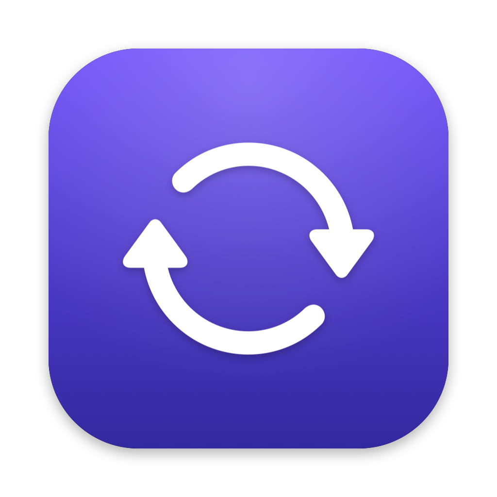
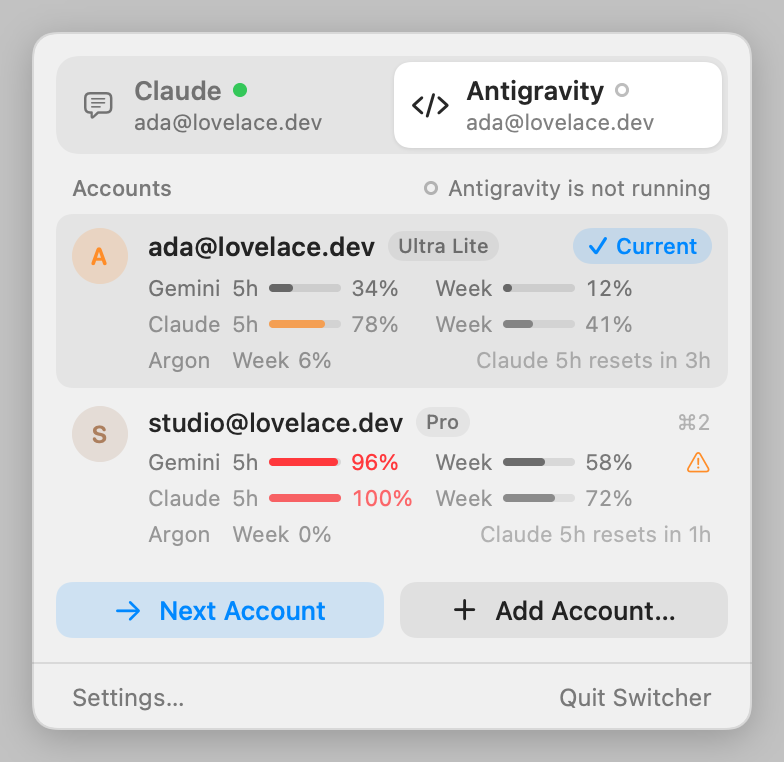
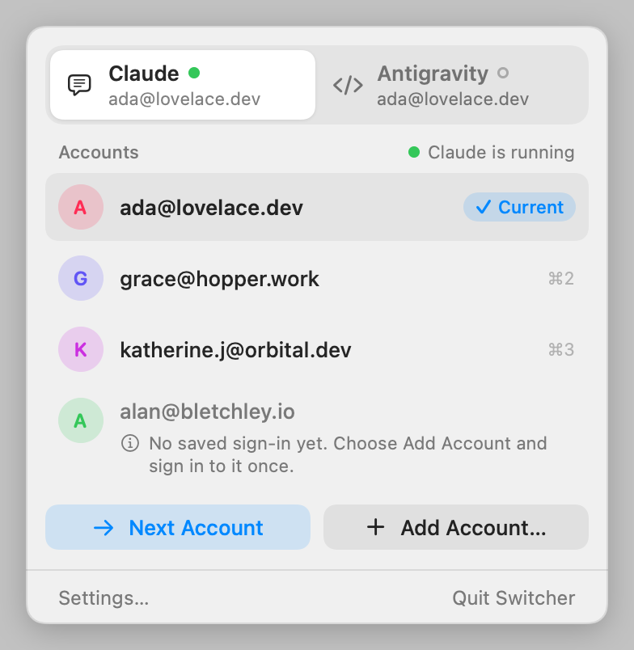

<p align="center">
  
</p>

<h1 align="center">Switcher</h1>

<p align="center">
  一键把 <b>Claude Desktop</b> 和 <b>Antigravity</b> 切到你的另一个账号。<br>
  原生 macOS 菜单栏应用，不用重新登录，也不用来回粘贴 token。
</p>

<p align="center">
  <a href="#安装">安装</a> ·
  <a href="#原理">原理</a> ·
  <a href="README.md">English</a>
</p>

<p align="center">
  <picture>
    <source media="(prefers-color-scheme: dark)" srcset="docs/popover-dark.png">
    
  </picture>
  <picture>
    <source media="(prefers-color-scheme: dark)" srcset="docs/claude-dark.png">
    
  </picture>
</p>

## 功能

- **一键切换账号。** 在菜单栏里点一个账号，Switcher 会退出应用、换上那个账号的登录，再重新打开，打开时已经是新账号。
  Antigravity 切一次大约两秒。
- **下一个账号。** 一个按钮切到列表里的下一个账号，停用的账号会跳过。
- **所有 Antigravity 账号的额度。** 每个账号的 Gemini 和 Claude 额度（5 小时和每周）并排显示，切之前就知道哪个号还有余量。
- **照常添加账号。** 点"添加账号"，应用会停在登录页，正常登录即可，Switcher 会记住它；原来的账号也会保留。
- **用邮箱区分账号。** 每个账号显示它的邮箱，从应用自己的文件里读出来。
- **附带命令行。** `switcher list`、`switcher switch claude 2`、`switcher usage` 等。

## 安装

**Homebrew**

```sh
brew install --cask raydocs/tap/switcher
```

**直接下载。** 从 [Releases](https://github.com/raydocs/switcher/releases) 下载 `Switcher.zip`，解压到
`/Applications`，然后运行一次 `xattr -dr com.apple.quarantine /Applications/Switcher.app`。
这个版本是 ad-hoc 签名、没有公证，不做这一步 macOS 会拦住它。

**从源码构建**（需要 Xcode 16 或 Swift 6 工具链）：

```sh
git clone https://github.com/raydocs/switcher && cd switcher
scripts/bundle.sh && cp -R dist/Switcher.app /Applications/
```

需要 macOS 14 或更新版本。

## 原理

一个应用的登录状态就是几个文件和钥匙串条目。Switcher 只是把它们挪来挪去，从不解密、读取或上传你的凭据。

| 应用 | 登录状态包括 |
|---|---|
| Claude Desktop | claude.ai 网页会话（Cookies、Local/Session Storage、IndexedDB）和 `config.json` 里的 token 缓存键，仍由 Claude 自己的密钥加密 |
| Antigravity | 登录钥匙串里的 OAuth token（`gemini` / `antigravity`）和 `app_storage.json` 里的 onboarding 键 |

每次切换都有日志：先退出应用，把当前登录放到一边，再放回目标账号的登录，全部落盘后才提交。中途出错或者断电，下次启动会把它做完或者撤销，
不会出现两个账号各一半的情况。登录状态只移动、不复制，所以一份保存的登录永远只在一个地方。

保存的登录放在 `~/Library/Application Support/Switcher/`。

**网络。** Switcher 唯一的网络请求是读取 Antigravity 额度：对每个保存的账号，在内存里用它自己的 token 刷新一次，然后向 Google 查询额度。
不会往其他任何地方发数据。

## 已知限制

- 在 Claude Desktop 4.23118 和 Antigravity 2.31 上测过。这两个应用时不时会改登录状态的存法，更新之后先切一次，确认切到的是对的账号。
- 不显示 Claude Desktop 的套餐用量（应用已经不再把它写进可读的文件）。

## 声明

Switcher 是独立项目，与 Anthropic 和 Google 无关，也未获得它们的认可或支持。Claude 和 Antigravity 是各自所有者的商标。
请只用于你自己的账号，并遵守各服务的条款。

## 许可证

[MIT](LICENSE)
